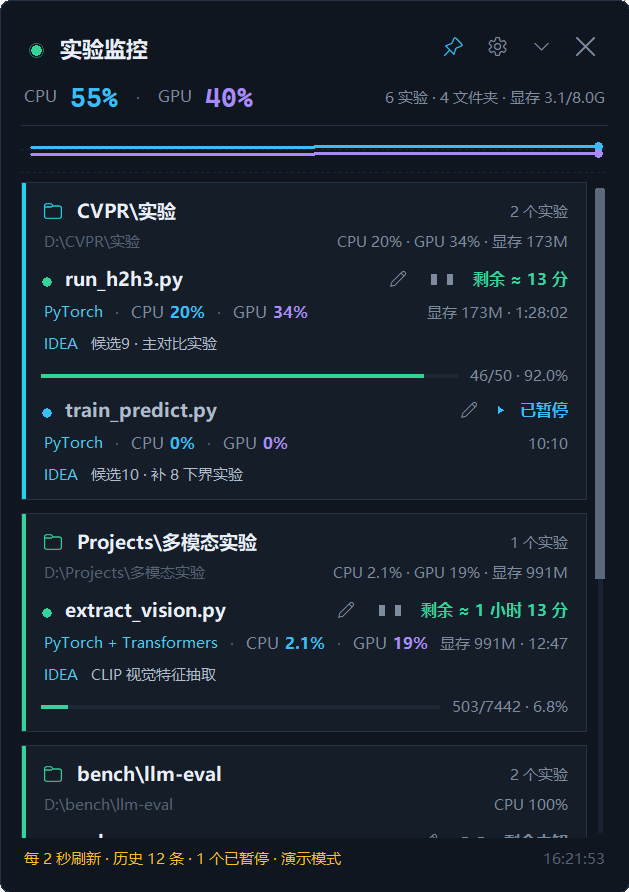
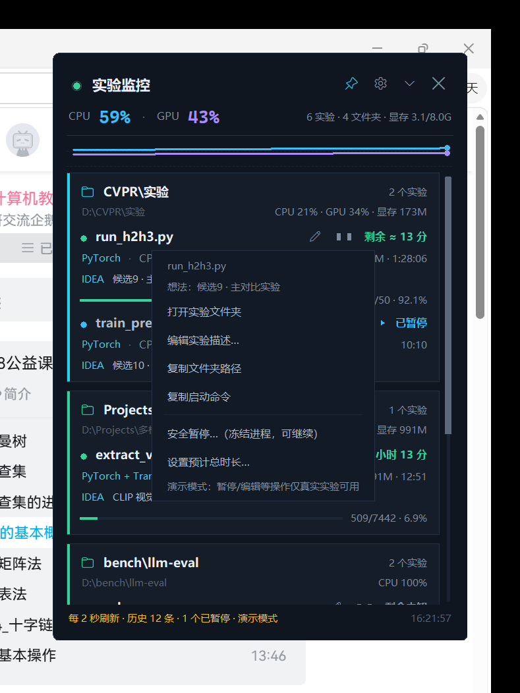
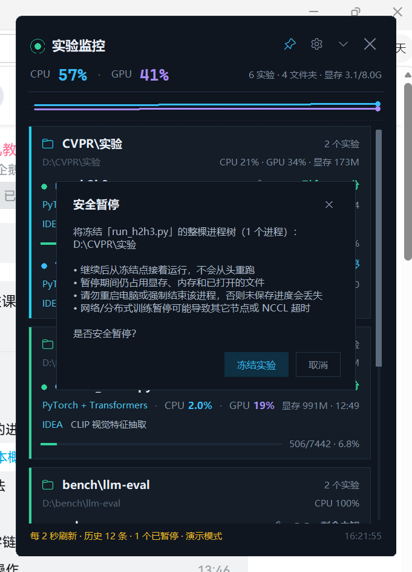
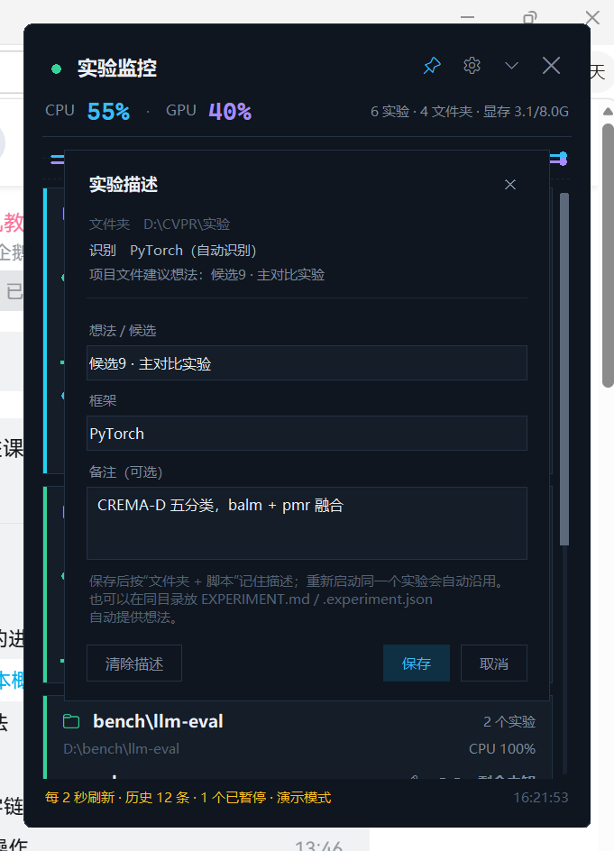
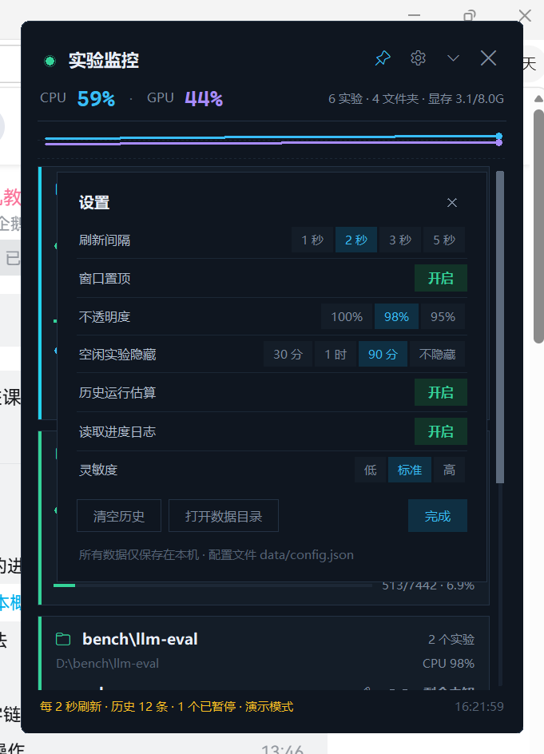

# 实验监控（Experiment Widget）

一个常驻 Windows 桌面的小面板，用来盯住后台实验：**谁在跑、占多少 CPU/GPU、从哪个文件夹来、对应哪个想法、还要多久、能不能先暂停**。



> 上图是演示模式（模拟数据）；真实运行效果见 [docs/preview_live.png](docs/preview_live.png)。

## 功能

- **实验识别**：自动发现 python / node / julia / matlab / R 等实验进程，并把 dataloader worker 等子进程聚合到同一个实验；
- **资源占用**：CPU 占整机百分比、GPU 利用率、进程显存、内存，附最近约 1 分钟走势；
- **来源文件夹**：读取进程真实工作目录（PEB），双击实验行直接打开文件夹；
- **实验描述**：自动识别框架（PyTorch / TensorFlow / HuggingFace…），记录想法/候选与备注，按“文件夹 + 脚本”沿用；
- **预计剩余时间**：进度日志 → 手动总时长 → 历史中位数 → 启动以来平均速度，多级兜底；
- **安全暂停**：冻结整棵进程树，继续时从冻结点接着跑，不需要从头重跑；
- **轻量安静**：无边框、半透明、可置顶、可折叠、空闲自动隐藏；后台线程采集，软件本身几乎不占资源。

## 快速开始

1. 双击 **`启动实验监控.vbs`**（无控制台窗口）；
2. 小组件出现在屏幕右上角，约 2 秒后开始显示实验；
3. 可选：双击 **`创建桌面快捷方式.vbs`** 生成带图标的快捷方式；
4. 开机自启：把快捷方式复制到 `Win+R` → `shell:startup` 打开的文件夹。

需要 **Windows 10/11 64 位** + **Python 3.9+（带 tkinter）**。
如果使用 DSH 自带 Python 运行时，启动器会自动找到它，无需额外安装。

```powershell
# 演示模式（不读取真实进程，适合预览界面）
python run_widget.py --demo

# 带控制台调试
调试启动.bat
```

## 界面说明


- **顶部**：CPU / GPU 整机占用、实验数量、显存、走势线；
- **实验卡片**：按来源文件夹分组，每行显示实验名、ETA、框架、CPU/GPU、显存和已运行时间；
  - 绿点＝运行中，黄点＝空闲，蓝点＋▶＝已暂停；
  - `IDEA` 行＝对应想法/候选，没有想法时显示备注；
  - 行末 `✎` 编辑描述，`❚❚ / ▶` 暂停或继续；
- **侧边滚动条**：悬停加亮、拖动滑块、点击轨道翻页、滚轮滚动；
- **底栏**：刷新间隔、历史样本数、已暂停数量、最近刷新时间；
- **标题栏**：置顶 / 设置 / 收起 / 退出；
- **鼠标**：拖动移动；悬停约半秒看完整命令、PID、日志、框架/想法、估算依据；双击打开来源文件夹；
- **右键**：打开文件夹、编辑描述、复制路径/命令、安全暂停/继续、设置预计总时长、指定进度日志、结束实验。



## 安全暂停（冻结进程）



点击行末 `❚❚` 或右键 → **安全暂停**：程序重新收集整棵进程树，用 Windows 原生接口冻结全部线程，并把记录写入 `data/paused.json`。点 `▶` 从冻结点继续。

**这是进程冻结，不是磁盘 checkpoint：**

- 继续后不需要重跑，内存中的模型/数据/日志状态都还在；
- 暂停期间仍占用显存、内存、文件句柄和端口/锁；
- **不要重启电脑或强制结束进程**，否则未保存进度会丢失；
- 分布式训练（`torchrun` / `deepspeed` / `mpirun` / NCCL 等）暂停可能导致其它节点超时，程序会额外提示；
- 小组件重启后可以恢复暂停标记并继续；**电脑重启后无法恢复**，重要实验请保留脚本自己的 checkpoint。

完整原理、状态机、失败处理和注意事项见 **[docs/pause.md](docs/pause.md)**。

## 实验描述：文件夹 / 框架 / 想法



每个实验可填写 **想法/候选**、**框架**、**备注**：

- 框架自动识别：命令行、conda/venv 环境名、`requirements.txt`、`pyproject.toml`、`environment.yml`、`setup.py` 等；
- 想法自动发现：实验目录里的 `.experiment.json`，或 `EXPERIMENT.md` / `IDEA.md` / `README.md` 第一行标题；
- 按“文件夹 + 脚本”指纹保存到 `data/descriptions.json`，同一实验下次运行自动沿用。

## 预计剩余时间



优先级：

1. **实时进度日志**：tqdm、`Epoch 3/50`、`step 1200/5000`、`fold 22/50`、`500/7442`、百分比；
2. **手动总时长**：右键 → 设置预计总时长（`90`、`90m`、`1.5h`、`2h30m`、`1:30`）；
3. **历史运行中位数**：同一个“文件夹 + 脚本”完整跑过至少一次后自动使用；
4. **启动以来平均速度**：不足两次采样时的低置信度粗估。

**Epoch 内进度会自动换算成整体进度**：

```text
日志：Epoch 65 ... 57%|████ | 4/7 [00:05<00:03]
命令：--epochs 80
显示：Epoch 65/80 · 57%      → 剩余约 11 分钟
```

日志发现支持命令行重定向、Git Bash 路径、`$变量` 文件名、项目 `logs/` 目录，并优先使用实验自己工作目录下的日志。为什么显示“剩余未知”、如何让 ETA 更准、如何写自定义规则，见 **[docs/eta.md](docs/eta.md)**。

快速排查：

```powershell
python tools/diagnose_eta.py
```

## 数据与隐私

运行时数据在 `data/`，**不会自动上传**：

| 文件 | 内容 |
| --- | --- |
| `data/config.json` | 设置、窗口位置、手动总时长 |
| `data/history.json` | 历史运行时长 |
| `data/descriptions.json` | 实验描述 |
| `data/paused.json` | 暂停记录 |
| `data/widget.log` | 调试日志（开启时） |

`.gitignore` 已排除 `data/`、日志和缓存。截图中的实验路径是本机真实路径；如果要公开仓库，建议先把 `docs/preview_live.png` 换成演示截图。

## 文档

| 文档 | 内容 |
| --- | --- |
| [docs/architecture.md](docs/architecture.md) | 架构、模块职责、数据流、运行时数据 |
| [docs/eta.md](docs/eta.md) | ETA 优先级、日志发现、Epoch 换算、未知排查、自定义规则 |
| [docs/pause.md](docs/pause.md) | 安全暂停原理、状态恢复、限制与失败处理 |
| [docs/development.md](docs/development.md) | 本地开发、测试、截图、启动器、提交前检查 |
| [CHANGELOG.md](CHANGELOG.md) | 版本变更记录 |

## 开发 / 测试

```powershell
# 单元测试（不需要真实 GPU）
python -m unittest discover -s tests -v

# 真实 Windows / GPU 测试
$env:WIDGET_LIVE_TESTS="1"
python -m unittest tests.test_winproc tests.test_gpu -v

# 端到端联调
python tools/integration_check.py

# 真实进程暂停/继续 + 重启恢复
python tools/pause_check.py

# ETA 诊断
python tools/diagnose_eta.py
```

测试会启动临时合成进程并在结束后清理，不会动用户正在运行的真实实验。详见 [docs/development.md](docs/development.md)。

## 项目结构

```text
插件/
├─ run_widget.py                 # Python 入口
├─ 启动实验监控.vbs              # 无控制台启动
├─ 调试启动.bat                  # 带控制台调试
├─ 创建桌面快捷方式.vbs
├─ experiment_widget/             # 主程序
├─ assets/widget.ico / widget.png
├─ docs/                         # 文档与截图
├─ tests/                        # 单元测试
└─ tools/                        # 联调、暂停验证、ETA 诊断、截图、演示实验
```

## 已知限制

- 默认只显示当前用户会话中有明显 CPU/GPU 活动的实验；系统进程和常见桌面应用默认忽略；
- 读取命令行/工作目录、暂停/继续需要与实验同一用户权限，管理员权限实验可能失败；
- 没有进度日志、没有历史、也没有手动总时长时，无法自动估算剩余时间；
- 暂停不是 checkpoint，重启电脑后无法恢复；分布式训练暂停有超时风险；
- 本程序不联网，不写入任何远程数据。

## 卸载

退出小组件（右上角 ✕）后删除本目录即可；如果创建了桌面快捷方式和开机自启项，一并删除。
